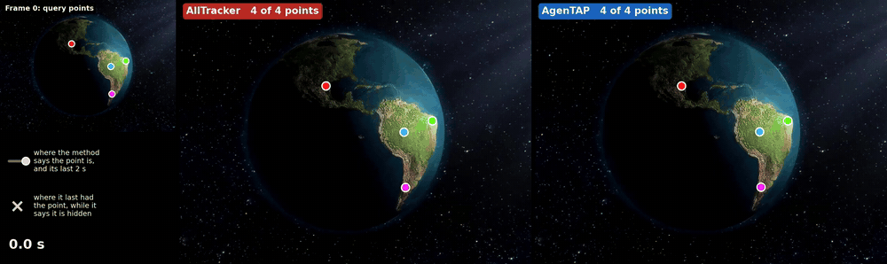

<h1>Tracking Any Point with Agentic Visual Reasoning</h1>

  <a href="https://xuweiyichen.github.io/">Xuweiyi Chen</a>*‡ &nbsp;·&nbsp; <a href="https://yaojin17.github.io/">Jin Yao</a>* &nbsp;·&nbsp; <a href="https://linzhanmou.com/">Linzhan Mou</a>* &nbsp;·&nbsp; Lei Gong*  
  <a href="https://lsn33096.github.io/">Di Liu</a> &nbsp;·&nbsp; <a href="https://holmes969.github.io/">Cheng Zhang</a> &nbsp;·&nbsp; <a href="https://mars-tin.github.io/">Ziqiao Ma</a> &nbsp;·&nbsp; <a href="https://sihanxu.me/">Sihan Xu</a> &nbsp;·&nbsp; <a href="https://adamharley.com/">Adam W. Harley</a>  
  <a href="https://jasonqsy.github.io/">Shengyi Qian</a>† &nbsp;·&nbsp; <a href="https://www.cs.virginia.edu/~zc3bp/">Zezhou Cheng</a>†

 University of Virginia &nbsp;·&nbsp;  Meta &nbsp;·&nbsp;  Princeton University &nbsp;·&nbsp;  University of Michigan

*Equal contribution &nbsp;·&nbsp; ‡Project lead &nbsp;·&nbsp; †Equal advising

  <a href="https://agentap.cs.virginia.edu/"><strong>Project Page</strong></a>
  &nbsp;·&nbsp;
  <a title="Coming soon"><strong>Paper</strong></a>
  &nbsp;·&nbsp;
  <a href="https://agentap.cs.virginia.edu/demo/"><strong>Demo</strong></a>
  &nbsp;·&nbsp;
  <a href="https://agentap.cs.virginia.edu/leaderboard/"><strong>Leaderboard</strong></a>
  &nbsp;·&nbsp;
  <a href="https://huggingface.co/datasets/uva-cv-lab/TrackingBench"><strong>Benchmark</strong></a>

## Updates

- **The paper, code and evaluation code are coming soon.**

## Overview

A general-purpose vision-language model (VLM) can surpass expert vision models in point localization and visibility prediction through agentic visual reasoning, without correspondence-specific fine-tuning. We introduce **AgenTAP**, an agent that directly predicts point coordinates and visibility and actively checks its own answers. Starting from its own estimate, the VLM autonomously chooses what to inspect and uses the resulting evidence to verify point identity and refine its predictions.
